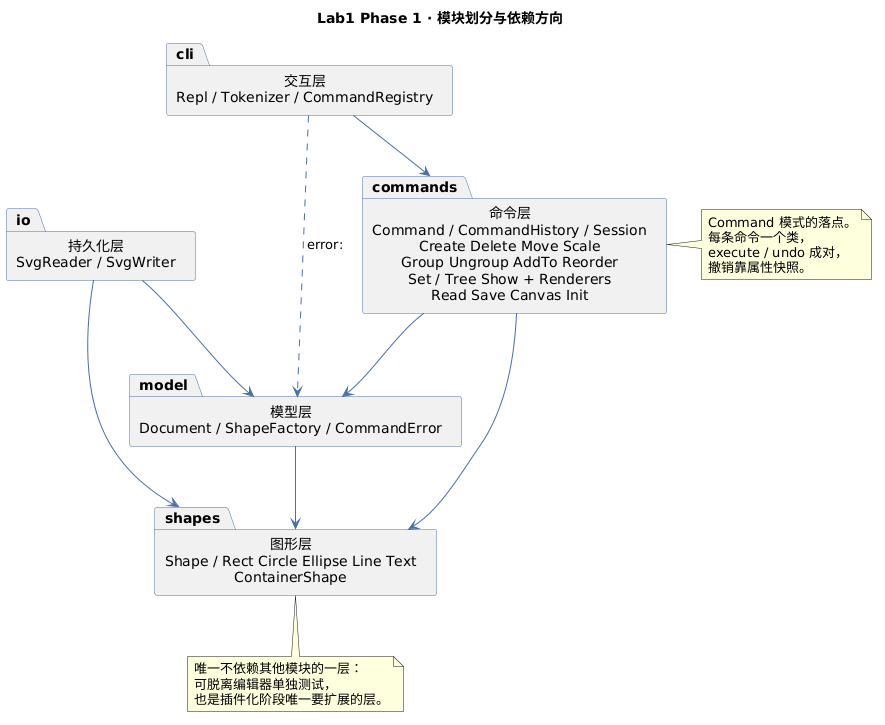

# Lab1 Phase 1 · SVG 编辑器（CLI）交付文档

TypeScript + 面向对象实现的 SVG 编辑器命令行。本文档对应作业 1.2 要求的四节：
架构方案、过程记录、一致性自查、质量保证手段。

## 架构方案

### 1. 模块划分

```text
src/
├── cli/        交互层：读行、分词、命令登记
├── commands/   命令层：每条命令一个类，撤销栈，渲染输出
├── model/      模型层：文档、id 索引、图形工厂、错误契约
├── shapes/     图形层：类层次与 Composite 容器
└── io/         持久化层：SVG 解析与序列化
```

| 模块        | 职责                                                                      | 关键类                                                             |
| ----------- | ------------------------------------------------------------------------- | ------------------------------------------------------------------ |
| `cli/`      | 只做三件事：读一行、切词、把异常渲染成 `error:`。不认识任何具体命令       | `Repl`、`Tokenizer`、`CommandRegistry`                             |
| `commands/` | 命令对象与撤销栈；`execute` 返回给用户看的摘要；渲染 tree/show 的文本格式 | `Command`、`CommandHistory`、`Session`、各 `*Command`、`*Renderer` |
| `model/`    | 当前文档（画布 + 图形树 + id 索引）、类型名到类的装配、全部错误消息       | `Document`、`ShapeFactory`、`CommandError`                         |
| `shapes/`   | 图形类层次。唯一知道"几何怎么变"的地方，可脱离编辑器单独测试              | `Shape`、五个叶子类、`ContainerShape`、`NumberText`                |
| `io/`       | SVG 文本 ↔ 对象树，缺 id 补全                                             | `SvgReader`、`SvgWriter`                                           |



> 源文件：`doc/architecture.puml`（PlantUML 包图），改图后重新导出即可。

### 2. 设计模式的选择

**① Command（作业强制要求，也是整个编辑器的骨架）**

每条 CLI 命令对应一个 `Command` 子类，`execute(session)` 与 `undo(session)` 成对：

```ts
export abstract class Command {
  public get kind(): CommandKind {
    return 'edit';
  }
  public abstract execute(session: Session): string;
  public undo(_session: Session): string {
    return '';
  }
  public redo(session: Session): string {
    return this.execute(session);
  }
}
```

`kind` 把作业的三条撤销规则直接写进类型，而不是散落成 if：

| kind      | 含义                             | 行为                              |
| --------- | -------------------------------- | --------------------------------- |
| `edit`    | 编辑命令                         | 入栈、解禁 undo、清空 redo        |
| `io`      | init / read / save / 改画布尺寸  | 清空双栈并锁定，直到下一次 `edit` |
| `display` | tree / show / help / undo / redo | 不改变撤销状态                    |

**undo 用快照而不是逆运算**，这是本项目最重要的一个决策：

- `move` 的逆是 `move(-dx,-dy)`，但 `0.1 + 0.2 - 0.2 ≠ 0.1`，浮点会漂；
- `scale` 的逆是 `scale(1/f)`，`1/1.1 * 1.1 ≠ 1`，反复缩放误差累积；
- `set` 没有旧值就还原不了；
- `delete` 还要记住原父容器与层级位置。

所以统一成：命令首次执行前，对**受影响图形的整棵子树**拍属性快照（`ShapeState`），
撤销时按 id 写回。结构上仍是 Command 模式，快照只是它的内部实现手段（Memento 用法）。
代价是内存，作业规模可忽略；收益是 `group` / `ungroup` / `delete` 这些结构性操作也能一套逻辑还原。

**② Composite（容器与叶子统一操作）**

`Shape` 基类定契约，`ContainerShape` 覆写 `move` / `scale` 为递归：

```ts
public override move(dx: number, dy: number): void {
  for (const child of this._children) child.move(dx, dy);
}
```

关键是**上层不区分容器和叶子**。这里踩过一次坑：`contains()` 最初写成
`child instanceof ContainerShape` 再递归，等于把类型判断散到调用方。后来改成模板方法：

```ts
// Shape：叶子只访问自己
public visit(visitor: (shape: Shape) => void): void {
  visitor(this);
}
// ContainerShape：覆写为深度优先
public override visit(visitor: (shape: Shape) => void): void {
  visitor(this);
  for (const child of this._children) child.visit(visitor);
}
```

于是查找、计数、序列化、子树快照全部不再需要 `instanceof`。

**③ Factory + Registry（作业允许的两处按名分派）**

- `ShapeFactory`：`rect` → `RectShape`，是唯一认识具体图形类型的地方；
- `CommandRegistry`：`move` → `MoveCommand`，同时持有命令用法表，`help` 由它生成。

两处都在文件头标了 `TODO(plugin-phase)`。除此之外全项目没有 `switch (tagName)`。

**④ 没有采用的模式**

- 没用 Visitor 做渲染：`tree` 只需一行摘要，让图形自己 `describe()` 更直接；
  真要做多套渲染（HTML、PNG）时再引入才是对的时机。
- 没用 Prototype 做复制：本阶段没有 duplicate 命令。

### 3. 依赖方向规则

**允许的依赖**（箭头 = 可以 import）：

```text
cli ──▶ commands ──▶ model ──▶ shapes
  │                     ▲         ▲
  └──▶ model（仅 CommandError）     │
        io ─────────────┴─────────┘
```

| 模块        | 可以依赖              | 理由                                                   |
| ----------- | --------------------- | ------------------------------------------------------ |
| `shapes/`   | 无                    | 最底层。不依赖编辑器即可单测，插件化阶段也只扩展这一层 |
| `model/`    | `shapes/`             | 文档要装图形、工厂要造图形                             |
| `commands/` | `model/`、`shapes/`   | 命令操作文档与图形                                     |
| `io/`       | `model/`、`shapes/`   | 解析要建图形、序列化要读文档                           |
| `cli/`      | `commands/`、`model/` | 只做装配与输出                                         |

**禁止的依赖及原因**：

| 禁止                 | 原因                                                       |
| -------------------- | ---------------------------------------------------------- |
| `shapes` → 任何模块  | 图形层一旦反向依赖模型，就无法单独测试，插件也无法独立分发 |
| `model` → `commands` | 文档不该知道"谁在改它"，否则命令模式退化成过程式调用       |
| `commands` → `cli`   | 命令不该依赖 stdin/stdout；输出靠返回值，测试才能直接断言  |
| `io` → `commands`    | 读写不应触发命令，否则 read 会污染撤销栈                   |

这条规则直接影响了实现：`TreeRenderer` / `ShowRenderer` 一开始放在 `cli/`，
但 `TreeCommand` 要调用它们，就成了 `commands → cli` 的反向依赖。最后把两个渲染器
移到 `commands/`——命令的返回值本来就是渲染好的文本，放这里语义也更准。

### 4. 变化点假设

| #   | 最可能变化的点                         | 留了什么                                    | 说明                                                                                                                      |
| --- | -------------------------------------- | ------------------------------------------- | ------------------------------------------------------------------------------------------------------------------------- |
| 1   | **新增图形类型**（`box` 等插件）       | `ShapeFactory` 集中登记 + `Shape` 抽象契约  | 插件化阶段把 switch 换成 `ShapeProvider` 注册表，内核零改动。`box` 的 `set` 传播语义可由插件子类覆写 `setAttr` 实现       |
| 2   | **新增命令**                           | `Command` 抽象类 + `CommandRegistry` 一张表 | 加一个类 + 一行登记；`help` 自动同步，不会出现文案与实现脱节                                                              |
| 3   | **输出格式调整**（tree 列、show 分组） | `Shape.describe()` 在图形自己身上           | 换格式只改渲染器或某个图形的 `describe`，不动命令                                                                         |
| 4   | **撤销粒度变化**（如合并连续 move）    | 命令对象自带快照，`CommandHistory` 只管栈   | 要合并只需在 `run` 里判断同类命令，命令本身不用改                                                                         |
| 5   | **持久化格式**（JSON 工程文件）        | **故意不留**                                | 作业只要求 SVG；SVG 本身就是可读文本，加一层自有格式属过度设计。真要加时 `io/` 是唯一改动点                               |
| 6   | **外部 SVG 的 `transform`**            | **故意不留**，只打印警告                    | 内部模型把变换烘焙进子孙坐标（`move g` 直接改子节点），语义简单一致。要支持就得引入矩阵栈，与"容器无 transform"的简化冲突 |

第 5、6 条是"决定不留"的两处，理由写在表里而不是留个空接口假装扩展性。

## 过程记录

按发生顺序记录有代表性的分歧与纠正。共同点是：AI 给的初版大多"能跑"，
问题出在**违反作业约束**或**边界没想清**，靠对照作业条款和写测试才发现。

**① 抽象方法命名暴露了概念混淆**

`Shape` 最初定义了 `getGeometryAttr` / `setGeometryAttr`。写到 `TextShape` 时发现文本内容是
元素体、不是几何属性，硬塞进"geometry"就不对了。改名 `getOwnAttr` / `setOwnAttr`，
并让基类只管 `fill` / `stroke` / `stroke-width` 这三个人人都有、且在 SVG 里确实通用的外观属性。
**教训**：命名不准往往说明职责没分清，早点改比后面加注释便宜。

**② `instanceof` 分支被自己抓住**

`ContainerShape.contains()` 初版写的是 `child instanceof ContainerShape && child.contains(...)`。
这正好是作业禁止的"到处按类型分派"，虽然它不在命令分派点上也一样是坏味道。
改成 `visit()` 模板方法后，`contains` 退化成三行，而且后面 `delete` 的子树注册、`move` 的子树快照
都直接复用了这个方法。**一次重构带来三处收益**，这是最划算的一笔。

**③ 撤销类别用布尔值不够**

最初 `Command` 只有 `undoable: boolean`。实现 `help` 时发现：`help` 不可撤销，
但它显然不该像 `init` 那样清空并锁定撤销栈。布尔值表达不了三种语义，
改成 `kind: 'edit' | 'io' | 'display'`，直接对应作业的三条规则。
**教训**：如果两个布尔分支里有第三个"都不是"的情况，说明类型选错了。

**④ 错误文案分散，测试先发现不了**

`ShapeFactory` 最初抛 `new Error('invalid number for create ...')`，
后来统一到 `CommandError`，消息变成 `invalid arguments, usage: ...`，原有测试立刻红了。
这件事本身说明错误消息必须只有一个来源——现在 12 条错误全部由 `CommandError` 的静态工厂产出，
测试断言的是消息体，`error:` 前缀只在 REPL 拼一次。**顺带避免了 `error: error:` 这种重复。**

**⑤ 删除容器的 undo 漏了递归注册**

`Document.unregister` 用 `visit` 递归注销整棵子树，但 `undo` 里最初只 `register` 了容器本身，
结果恢复后子节点查不到。测试 `删除容器后 undo 恢复整棵子树，索引同步` 直接暴露。
修法是恢复时同样 `visit` 整树注册。**教训**：对称操作（注销/注册）必须用同一个遍历口径。

**⑥ 测试预期与真实栈深度不符**

写"撤销完全部编辑后报 nothing to undo"时，我以为 init 后只有一条 move 可撤，
实际 `create` 也在栈里——init 是 io 命令会被清空，但随后的 create 是编辑命令。
测试跑出来没抛错才发现。这条恰好验证了作业"一条编辑命令 = 一个 undo 单元"的语义：
栈里装的是命令，不是"文档状态"，所以必须按真实历史逐条推演。

**⑦ tree 的根行被列对齐波及**

第一版渲染把根行也纳入了标签列宽计算，输出成 `svg         (800x600)`，
与作业的 `svg (800x600)` 不符。修法是根行不参与对齐，单独用单空格拼接。

**⑧ 工具链的一个真坑**

有一次 `npm run verify | tail -4` 返回的是 `tail` 的退出码，lint 明明报错却仍然执行了提交，
只好 `--amend` 修正。**教训**：管道会吞掉前一个命令的退出码，判断成败要看 `$?`，
所以后面都改成 `npm run verify > log 2>&1; echo $?`。

**⑨ 自查表自己揪出第三处分派点**

写「一致性自查」时拿 `rg "switch \(.*tag"` 复核"按名分派只有两处"，结果在
`SvgReader` 里命中 `switch (tag)`——解析器为了把 `<rect x=… y=…>` 的属性名映射成
构造参数顺序，自己长出了一份类型分支。测试全绿、行为也正确，但它让"新增图形类型只改工厂"
这条承诺失效：加 `box` 得同时改解析器。修法是把「构造参数 ← 属性名」的映射表也交给
`ShapeFactory`（`PARAM_ATTRIBUTES` + `fromAttributes` 转调 `create`），解析器只负责
读出属性字典与元素文本。**教训**：架构承诺要拿命令去验证，不能凭印象。

**⑩ 整段会话回放又打回三处**

收尾验收时把作业 §6、§6.1 两段 transcript 原样喂给 CLI 回放并逐字比对，暴露三个单测照不到的问题：

1. `tree` 的属性列只按**标签**宽度对齐，深一层的行整体右移——作业示例里整棵树是一列。
   改成按「缩进 + 标签」的总宽算列宽后，§5.1 的树逐字一致。
2. `group` 按**参数顺序**排子节点，`group g a b` 与 `group g b a` 会得到不同 z-order。
   作业要求"从各自原父容器摘出，**保持相对顺序**"，改为按文档先序排，编组不再动绘制次序。
3. 单个子节点时输出 `1 children`，补了单复数。

**教训**：单测全绿只能证明"每条断言成立"，证明不了"全局排布正确"；
验收要拿作业原文整段回放，比对的是整块输出而不是某个 `toContain`。

## 一致性自查

### 1. 模块划分：实际目录与方案是否一致

**一致**。`src/` 下五个目录与方案表一一对应，没有额外顶层目录。

**有一处偏差并已修正**：`TreeRenderer` / `ShowRenderer` 最初建在 `cli/`，
与"commands 负责命令输出"的分工不符，且会造成 `commands → cli` 的反向依赖。
已移到 `commands/`，本文档第 3 节记录了原因。除此之外没有其他偏差。

**没有偏差但值得说明**：`Session` 放在 `commands/` 而不是 `model/`。
它同时持有 `Document`（model）和 `CommandHistory`（commands），放 model 会让 model 依赖 commands，
放 commands 才是合法方向。

### 2. 依赖方向：规则有没有被违反

抽查方式与结果：

| 检查项                              | 命令                                                    | 结果   |
| ----------------------------------- | ------------------------------------------------------- | ------ |
| `shapes/` 是否 import 上层          | `rg "from '\.\./(model\|commands\|cli\|io)" src/shapes` | 0 命中 |
| `model/` 是否 import commands / cli | `rg "from '\.\./(commands\|cli)" src/model`             | 0 命中 |
| `commands/` 是否 import cli         | `rg "from '\.\./cli" src/commands`                      | 0 命中 |
| `io/` 是否 import commands / cli    | `rg "from '\.\./(commands\|cli)" src/io`                | 0 命中 |

另外两处**按名字分派**也核对过，全项目仅此二处：
`ShapeFactory.create` 的 `switch (type)`、`CommandRegistry.registerDefaults` 的命令名表。
两者都标了 `TODO(plugin-phase)`。`read` 的标签分派不再单独存在：`SvgReader` 把属性字典
交给 `ShapeFactory.fromAttributes`，后者靠一张属性名表复用同一个 `create`。

代码里不存在 `switch (tagName)` 形态的图形分派；`instanceof ContainerShape` 只出现在
`ContainerShape.isContainer` 静态守卫内部（用于类型收窄），业务代码全部通过 `visit` 遍历。

### 3. 交付物与作业要求的对应

| 作业要求                                  | 落地位置                                                                               |
| ----------------------------------------- | -------------------------------------------------------------------------------------- |
| 1.1 git 分步提交 + 远程仓库 + `final` tag | 分步提交，每完成一个任务项一笔；`local/plan.md` 的看板可对到每一项；tag 打在最终提交上 |
| 1.2 `doc/README.md` 四节                  | 本文件                                                                                 |
| 2.1 范式：OOP、一类一文件、禁止贫血模型   | `src/` 每个文件一个类，无裸函数导出                                                    |
| 2.1 按名分派只允许两处                    | `ShapeFactory`、`CommandRegistry`                                                      |
| 3 命令总表 19 条 + `exit`/`quit`          | `src/commands/`，`help` 由注册表生成，与实际实现同源                                   |
| 4.1 `create` 参数表与 `in` 子句           | `ShapeFactory` + `CreateCommand`                                                       |
| 4.2 12 条错误信息                         | `CommandError`，`Contracts.test.ts` 逐字断言                                           |
| 4.3 undo/redo 粒度与 io 锁定              | `CommandHistory` + `Command.kind`                                                      |
| 5 显示格式                                | `TreeRenderer`、`ShowRenderer`                                                         |
| 6 典型会话                                | 见下节「功能完整性怎么确认」                                                           |

非交付物（作业原文、执行计划书）放在 `local/`，已进 `.gitignore`，不进仓库。

## 质量保证手段

### 测试

`npm test`：**7 个测试文件、107 个用例**，覆盖率 **85.9% 语句 / 89.7% 分支**。

| 层次     | 文件                     | 覆盖内容                                                |
| -------- | ------------------------ | ------------------------------------------------------- |
| 图形层   | `ShapeHierarchy.test.ts` | 多态、Composite 递归、快照还原、工厂参数                |
| 命令层   | `CommandFlow.test.ts`    | 分词、文档生命周期、create/move/scale、undo 语义        |
| 结构操作 | `Containers.test.ts`     | group/ungroup/addto/front/back 与撤销                   |
| 显示     | `Display.test.ts`        | tree 对齐与缩进、show 分组、set 白名单                  |
| 持久化   | `IO.test.ts`             | 缺 id 补全、顺序保持、round-trip 无损                   |
| 契约     | `Contracts.test.ts`      | 作业 4.2 每条错误消息逐字断言 + 边界用例                |
| 端到端   | `Cli.test.ts`            | 真起进程：横幅、`error:` 前缀只出现一次、失败不中断会话 |

### 静态检查

- `tsc --noEmit`，开启 `strict`、`noUncheckedIndexedAccess`、`exactOptionalPropertyTypes`、
  `noImplicitOverride`——数组下标与可选属性都不会悄悄变 `undefined`；
- ESLint：禁止 `any`、禁止 `console`（输出统一走 `process.stdout`）、
  字段必须显式可见性修饰符、`eqeqeq`；
- Prettier 统一格式，`npm run format:check` 可验证。

一条命令可复现全部检查：

```bash
npm run verify   # typecheck + lint + test
```

### 功能完整性怎么确认

三层证据：单测、整段会话回放、错误契约逐条比对。收尾时按作业原文重新过了一遍：

| 验收项               | 做法                                                                      | 结果            |
| -------------------- | ------------------------------------------------------------------------- | --------------- |
| 19 条命令 + `exit`   | 按 §3 总表逐条执行，含 `in` 子句、省略 `[w] [h]`、`save` 无参回写读入路径 | 行为与语法一致  |
| §4.1 create 参数表   | 六种类型逐个建；省略 `fill`/`stroke`；text 用中文与带空格内容             | 一致            |
| §4.2 的 12 条错误    | 在 CLI 里逐个触发，与表格逐字比对                                         | 12 / 12 一致    |
| §4.3 撤销规则        | `group` 一次全还原、io 后禁止、新编辑清空 redo、锁定后下次编辑解禁        | 一致            |
| §5.1 / §5.2 显示格式 | 与作业示例逐字比对，含属性列的跨层对齐                                    | 一致            |
| §6 / §6.1 两段会话   | 整段 transcript 原样回放                                                  | 逐条一致        |
| 容器与叶子统一操作   | 对 `g` 做 `move`/`scale`/`delete`/`set`，与对叶子同效                     | 一致            |
| round-trip           | `read` → `save` → 再 `read`，diff 两份 SVG                                | 只多出补出的 id |

典型回显：

```text
svg> create rect bg 0 0 800 600 #ffffff
rect#bg created
svg> move c1 30 0
circle#c1 moved to (130,100)
svg> move node2 0 100
g#node2 moved by (0,100)
```

叶子报"移到哪"（`moved to`），容器没有单一坐标，改报增量（`moved by`）——两条消息都照作业示例。

`read other.svg` 的输出与作业第 6 节逐字一致，包括
`warning: assigned id rect1 to unnamed <rect>` 与 `read other.svg (7 elements)`；
`save` 产物再用 `read` 读回，`tree` 输出完全相同（有 round-trip 测试守着）。

### 尚未覆盖的部分

- `cannot ungroup composite shape` 这条错误已定义但**本阶段触发不了**——`box` 属插件化阶段，
  内核里没有任何 composite 类型。留到下一阶段接上插件后再补测试。
- `read` 忽略 `transform` / `style` 属性，只对前者打印警告（见变化点假设第 6 条）。
